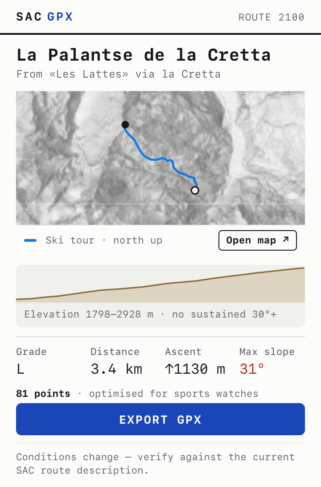
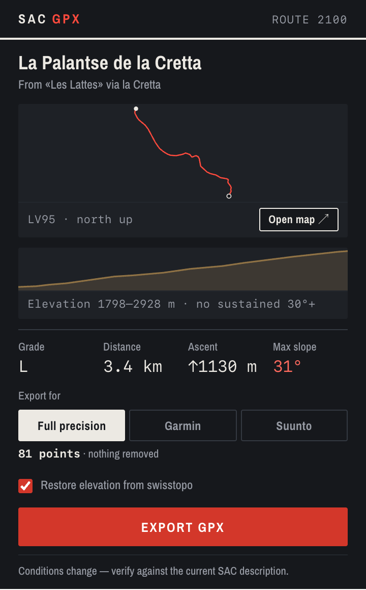
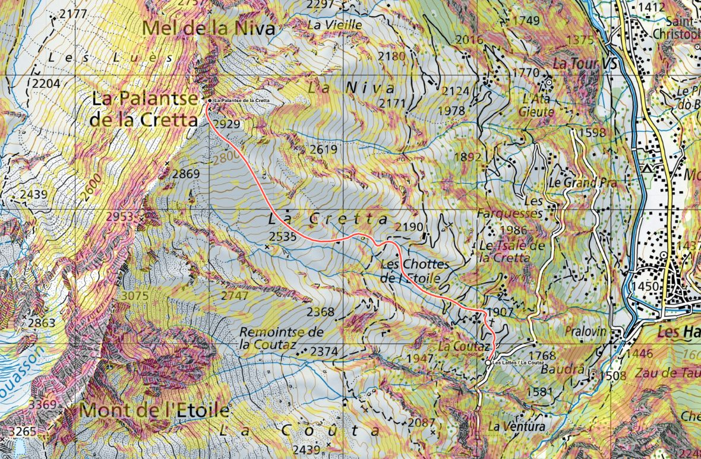
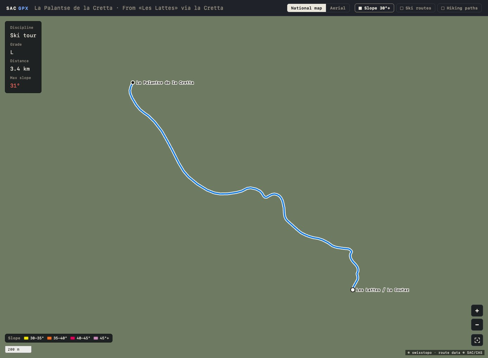

# SAC GPX

Export routes from the [SAC Route Portal](https://www.sac-cas.ch/en/huts-and-tours/sac-route-portal/)
as GPX, with elevation restored from swisstopo terrain data.

The Swiss Alpine Club maintains the most current route descriptions in
Switzerland, but deliberately offers no GPX export of them. Its
[FAQ](https://www.sac-cas.ch/de/meta/faq/sac-tourenportal/) explains why: a
drawn line is only approximate, and conditions decide the real path, especially
in winter, on glaciers and in pathless terrain. Members can draw and export
their own tracks in the portal instead.

This extension requests the same route data the portal's own map uses and
writes it to a file, keeping the information that makes an SAC route worth
having: the grade, the timings, the per-segment description. It shows the
route on swisstopo's maps first, so you can check it before it goes on a watch.

## Personal use

- **For your own use, with your own SAC login.** The extension runs in your
  browser and uses your existing session on the portal. Members-only routes
  need an SAC membership or portal subscription. Nothing is sent to any server
  but SAC's and swisstopo's.
- **Route data is © Schweizer Alpen-Club SAC.** The extension does not copy,
  store or share it anywhere. Don't redistribute the files it writes.
- **A line is a plan, not the route.** SAC gives no guarantee that its routes
  are current, correct or complete, and you follow them at your own risk. Read
  the current description and check conditions before relying on an exported
  track.

<p>
  
  
</p>

The panel draws the route over swisstopo shaded relief, along with its
elevation profile, before you export — so a route that is reversed, gated or
simply not the one you meant is visible in a glance rather than discovered on
the mountain.

### On the real map

Clicking the preview opens the route on swisstopo's own tiles, with the slope
classes over 30° that the SLF recommends for ski touring.

<p></p>

All layers come from swisstopo's open WMTS service — national map, aerial
imagery, slope classes, the ski touring network and the signposted hiking
network. No API key, and nothing is proxied through anyone else.

The slope bands are named in a legend keyed to the layer's own colours, sampled
from the rendered tiles rather than guessed, so the key cannot drift from the
map. Zoom is continuous: tiles are fetched at the nearest integer level and the
container is scaled for the fraction.

<p></p>

<sub>Interface shot only — the map tiles are replaced with a flat ground so the
controls can be read against their own contrast rather than against terrain.</sub>

### Route colours

The line takes its colour from the route's discipline, so a ski tour and an
alpine route are distinguishable before you read anything:

| Discipline | Colour | Why |
|---|---|---|
| Mountain hiking | red | the red of a Swiss Bergweg waymark |
| Ski tour | azure | matches swisstopo's own ski touring layer |
| Snowshoe tour | teal | winter, but not mistakable for a ski line |
| Alpine tour / climbing | violet | |
| Via ferrata | burnt orange | |

The palette is constrained by the slope overlay it has to coexist with. Its
bands run yellow → orange → magenta → violet, which occupies most of the warm
half of the wheel, so nothing is drawn in yellow and the alpine violet is a
blue-leaning ~261° against the band's magenta-leaning ~312°. Each colour must
clear each band by hue **or** by lightness — a test enforces it, and the light
variants are the ones checked, because the map draws over pale tiles no matter
how dark the surrounding interface is.

### Line style — the SAC terrain notation

Colour says what kind of day it is; the line style says what the ground is
doing. The portal publishes a `style` on every segment, and on its own map it
is not decoration — it is the terrain grade of that leg, which the description
would otherwise have to carry in prose. It is adopted here verbatim:

| Style | Hiking | Alpine | Ski |
|---|---|---|---|
| solid | on a trail, up to T3 | marked path or traces | approximate itinerary |
| dashed | exposed or pathless, T4+ | unmarked path or traces | increased caution |
| dotted | — | pathless, line is indicative | on foot, from a ski depot |

The casing carries the same dash as the line, so a dashed leg reads as gaps in
the route rather than as a solid white ribbon with colour laid over it. A key
appears on the map naming what each style means **for that discipline**, and
only when the route actually draws more than one of them — on a route that is
solid end to end the key would explain a distinction the map never makes.

Because the dash now means terrain, it cannot also mean "variant": alternatives
are set apart by colour and weight alone.

The colours are deliberately *not* SAC's. The portal draws hiking green and
climbing orange-red, both of which would sit on top of the slope overlay's own
yellow–orange–magenta bands that the palette above is built to clear. Line
style is the half of the notation that carries terrain, so that is the half
taken as published.

### Winter terrain

For ski and snowshoe routes the panel samples the terrain model either side of
every track point and reports what the line actually crosses. Max slope sits in
the fact row alongside grade, distance and ascent — it is a measurement like
the others, not a warning banner — and turns red past 30°:

```
Grade   Distance   Ascent      Max slope
L       3.4 km     ↑1130 m     31°
```

Sampling four offset points per vertex would normally mean four requests per
point; instead the whole route is offset in each of the four directions and
sent as four route-shaped lines, so the entire analysis costs four batched
requests regardless of route length.

**This is terrain description, not risk assessment.** Slope at the track point
is not the slope you stand on — a summer path cut into a hillside samples steep
— and nothing here models what hangs above you. For actual avalanche
assessment use [skitourenguru.ch](https://skitourenguru.ch).

### Watch exports

There is one export, optimised for sports watches. The two vendors' constraints
were never in conflict — one is a point cap, the other a waypoint requirement —
so the single profile takes the stricter of each and produces a file that works
on either brand:

- **2000 points**, Suunto's budget rather than Garmin's 2500
- **waypoints snapped onto the track**, which Suunto needs and Garmin ignores

Neither vendor documents a hard GPX point limit, so the budget is a
conservative working default rather than a claimed specification — and the
panel always shows the resulting count, so nothing is hidden behind a brand
name.

The snapping is a correctness fix, not a preference: the Suunto app silently
drops any waypoint whose coordinates do not coincide with a route point, so
snapping is the difference between the hut appearing on your watch and not
existing at all.

## How it works

The portal renders each route from a TYPO3 AJAX endpoint that returns the full
route as JSON, including GeoJSON `LineString` geometry in **EPSG:2056 (LV95)**:

```
https://www.sac-cas.ch/de/?type=1567765346410&tx_usersaccas2020_sac2020[routeId]=207&output_lang=de
```

No computer vision, no tracing pixels off a map image — these are the survey
coordinates the map itself is drawn from.

Three things happen on export:

1. **Fetch** — a content script on `www.sac-cas.ch` requests the route JSON.
   The call is same-origin, so the browser attaches your existing member
   session cookie. The extension never sees, stores or transmits a credential.
   Route pages are recognised in all four portal languages — the path segment
   itself is translated (`sac-tourenportal`, `portail-des-courses-du-cas`,
   `portale-escursionistico-del-cas`, `sac-route-portal`).
2. **Orient** — SAC stores segment geometry in whatever direction it was
   digitised, not the direction of travel. Route 207 is stored hut-first, so a
   naive export descends 1197 m and climbs 3 m. Segments are chained outward
   from the route's departure point and reversed where needed.
3. **Enrich** — the geometry is strictly 2D; there is no elevation anywhere in
   the payload. Each line is sampled against swisstopo's terrain model so the
   exported track carries a real profile.

For route 207 the result is 1196 m of ascent against SAC's published 1200 Hm.

Elevation is always restored — there is no option to skip it. SAC publishes no
elevation at all, so turning it off could only ever produce a strictly worse
file, and the one case that might justify it (swisstopo unreachable) already
degrades to a flat track on its own rather than failing the export.

### Access

Routes carry an `availability` field. `free` routes export without signing in.
`limited` routes return no geometry at all unless the request carries a member
session — sign in to the portal, reload, and export again.

## Install

Not on the Chrome Web Store. Load it unpacked:

1. Download this repository (**Code → Download ZIP**) and unzip it
2. `chrome://extensions` → enable **Developer mode**
3. **Load unpacked** → select the unzipped folder
4. Open any route in the SAC Route Portal, signed in for members-only routes

An **Export GPX** stamp appears bottom-right once a route is detected, so the
export only works on a route page. The toolbar icon
opens a panel that previews the route line and elevation profile before you
export.

## Development

```sh
npm test          # no dependencies
```

The route tests run against recorded SAC responses. Those are SAC's data, so
they stay out of this public copy, along with the tests that read them.

The suite includes preflight checks for the things that only fail at *Load
unpacked* — manifest paths, import resolution, web-accessible resources — which
unit tests cannot see.

There is no build step. `src/lib/` is plain ES modules, imported directly by
the content script, the service worker and the popup.

| File | Role |
|---|---|
| `src/lib/swiss.js` | LV95 ↔ WGS84, distances, bounds |
| `src/lib/sac.js` | Route endpoint, URL parsing, payload normalisation |
| `src/lib/orient.js` | Segment ordering and direction of travel |
| `src/lib/elevation.js` | swisstopo terrain sampling |
| `src/lib/gpx.js` | GPX 1.1 serialisation, route statistics |
| `src/lib/render.js` | Geometry → SVG for the preview |
| `src/lib/disciplines.js` | Route colour and label per SAC discipline |
| `src/lib/viewport.js` | Zoom rate, anchored zoom, scale bar |
| `src/lib/terrain.js` | Slope and aspect sampling, steep-section detection |
| `src/lib/simplify.js` | Douglas–Peucker, returning indices |
| `src/lib/devices.js` | The sports-watch export profile |
| `src/lib/mercator.js` | Web Mercator tile maths |
| `src/lib/layers.js` | swisstopo WMTS layer definitions |
| `src/content.js` | Authenticated fetch, in-page button, file write |
| `src/background.js` | Cross-origin terrain calls only |
| `src/popup/` | Preview panel |
| `src/map/` | Full map view (tile renderer, no mapping library) |

Icons are generated: `python3 icons/make-icons.py`.

### Permissions

`storage`, plus host access to `www.sac-cas.ch` and `api3.geo.admin.ch`.
There is deliberately no `downloads` permission — the file is written from
page context via a blob URL.

## Caveats

- `type=1567765346410` is an undocumented TYPO3 parameter. If SAC changes it,
  export breaks; `fetchRoute` fails loudly rather than silently producing an
  empty file.
- Elevation comes from a terrain model, not a barometric track. It follows the
  ground, which is what you want for planning and wrong for glaciated or
  tunnelled sections.
- Slope figures describe the ground the line crosses. They are not an avalanche
  risk assessment and must not be used as one.
- On a hut's landing page the hut's id is read as a route id, so the export
  fails there. Open a route from the hut instead.
- See **Personal use** above: route data is © Schweizer Alpen-Club SAC, and
  conditions change.

## Licence

MIT for the code. Route data is not ours to licence.
